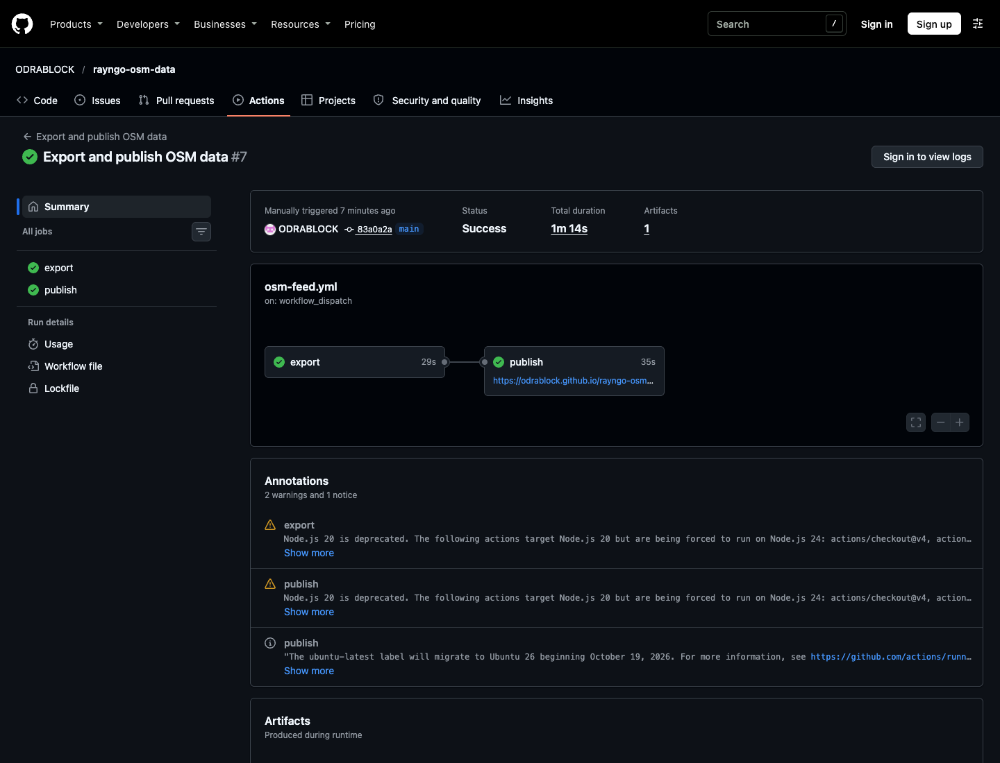
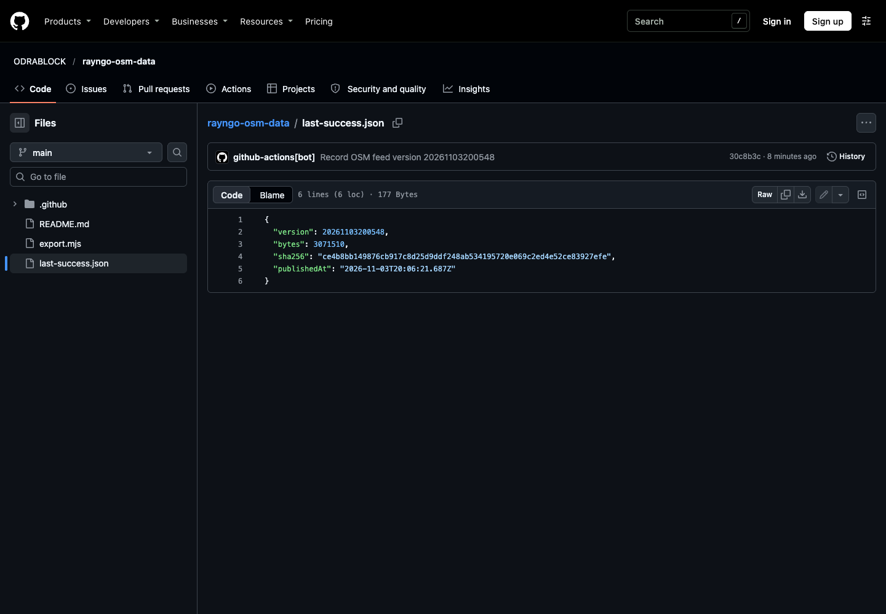

# Betrieb des RAYNGO-OSM-Feeds

Stand: 03.11.2026. Diese Anleitung beschreibt den **öffentlichen Datenfeed** für die
RAYNGO-Routenvorschau. Der Feed enthält keine Nutzerroute und keine Live-Meldungen.
OSM-Kartierung belegt weder Vollständigkeit noch den aktuellen Betriebszustand einer
Kontrolle. Für OSM-Daten gelten [ODbL und Attribution](https://www.openstreetmap.org/copyright).

## Adressen und Dateien

| Zweck | Adresse oder Datei |
| --- | --- |
| Öffentlicher Einstieg | [manifest.json](https://odrablock.github.io/rayngo-osm-data/manifest.json) |
| Versionsdatei | `https://odrablock.github.io/rayngo-osm-data/osm-enforcement-<version>.json` |
| Letzte erfolgreiche Veröffentlichung | [last-success.json](../last-success.json) |
| Zeitplan und Deployment | [osm-feed.yml](../.github/workflows/osm-feed.yml) |
| Export und Prüfung | [export.mjs](../export.mjs), [verify.mjs](../verify.mjs) |

Das Manifest enthält `schema`, `version`, `bytes` und `sha256`. `version` ist der
UTC-Zeitstempel des **Exports**, kein Nachweis für das Alter des QLever-Indexes.
Die App lädt die Versionsdatei aus demselben Verzeichnis und prüft deren Größe,
SHA-256 und Format vor dem atomaren Wechsel. Bei einem Fehler bleibt ihr letzter
gültiger Stand erhalten; ohne Update nutzt sie die eingebetteten Daten.

## Automatischer Ablauf

1. GitHub Actions startet montags um **04:17 UTC** oder nach einem manuellen
   `workflow_dispatch`. Geplante GitHub-Läufe können verspätet sein oder ausfallen.
2. Der Exportjob nutzt `macos-15-intel` und Node.js 24. `export.mjs` fragt den
   [QLever-OSM-Index](https://qlever.dev/osm-planet) ab: Knoten mit
   `highway=speed_camera` sowie gerichtete Relationen `type=enforcement` und
   `enforcement=average_speed` mit eindeutigem Start, Ende und durchgehenden
   `section`-Wegen. Der Ausschnitt umfasst 35–72° N und 25° W–45° O.
3. Der Export schreibt eine JSON-Versionsdatei und `manifest.json`. Er bricht bei
   weniger als 30.000 Kameraknoten, weniger als 500 gültigen Abschnitten oder mehr
   als 12 MiB Nutzdaten ab. Ein fehlgeschlagener Export veröffentlicht nichts.
4. Nach erfolgreichem Export lädt der Job beide Dateien als **ein** Pages-Artefakt
   hoch. Der zweite Job veröffentlicht dieses Artefakt auf GitHub Pages. Erst nach
   erfolgreichem Deployment schreibt er `last-success.json` in den Standardzweig.
   Der kleine Commit soll der [GitHub-Inaktivitätsabschaltung](https://docs.github.com/en/actions/reference/workflows-and-actions/events-that-trigger-workflows#schedule)
   geplanter Workflows vorbeugen; die nächste tatsächliche Ausführung muss dennoch
   beobachtet werden.
5. Ein RAYNGO-Build mit der eingetragenen Feed-Adresse prüft beim App-Start
   höchstens alle sieben Tage. Er überträgt dabei keine Route an den Feed.
   Bereits installierte Builds ohne diese Adresse erhalten dadurch kein Update.

Die [GitHub-Pages-Dokumentation](https://docs.github.com/en/pages/getting-started-with-github-pages/using-custom-workflows-with-github-pages)
beschreibt das Artefakt- und Deployment-Verfahren. Auf GitHub-gehostetem Ubuntu
antwortete QLever beim ersten Versuch mit HTTP 403; der getestete Intel-macOS-Runner
lieferte den vollständigen Export. Ein Runner-Wechsel braucht einen erneuten
Ende-zu-Ende-Test.

## Manuell auslösen und prüfen

Im Repository unter **Actions → Export and publish OSM data → Run workflow** den
Zweig `main` wählen. Mit angemeldeter GitHub-CLI geht es ebenso:

```sh
gh workflow run osm-feed.yml --repo ODRABLOCK/rayngo-osm-data --ref main
gh run list --repo ODRABLOCK/rayngo-osm-data --workflow osm-feed.yml --limit 5
```

Nach Abschluss müssen `export` und `publish` erfolgreich sein. Anschließend im
Repository mit Node.js 24 den **öffentlich erreichbaren** Feed unabhängig prüfen:

```sh
node verify.mjs
```

Das Skript verlangt direkte HTTPS-Antworten mit HTTP 200, prüft Manifest-Schema,
Version, Dateigröße, SHA-256, Koordinaten und Mindestumfang und beendet sich bei
einem Fehler mit Status ungleich null. Danach `last-success.json` mit der
ausgegebenen Version und Prüfsumme vergleichen. Direkt nach dem Deployment kann
der Pages-Abruf kurz verzögert sein; nach vollständig abgeschlossenem Workflow
erneut prüfen.

Für einen lokalen Export ohne Veröffentlichung:

```sh
node export.mjs /tmp/rayngo-osm-output
```

Dieser Befehl braucht Zugriff auf QLever. Er ändert keine GitHub-Pages-Dateien.

## Fehlerbehandlung und Rückfall

| Befund | Nächster Schritt | Wirkung auf die App |
| --- | --- | --- |
| Export fehlgeschlagen oder QLever nicht erreichbar | Fehlerlog im Actions-Lauf prüfen; Quelle/Runner nicht ungeprüft wechseln; später manuell erneut starten | Pages behält den bisherigen Auszug |
| `publish` fehlgeschlagen | Pages-Job und Berechtigungen prüfen; `node verify.mjs` gegen die aktuelle öffentliche Adresse ausführen | Letzter gültiger App-Stand bleibt verfügbar |
| Manifest, Größe, SHA-256 oder JSON ungültig | Feed nicht als gültig melden; Export und Deployment korrigieren und vollständig neu ausführen | Client verwirft den Kandidaten |
| Geplanter Lauf fehlt | Workflow-Status und letzte Runs prüfen; bei Deaktivierung durch GitHub wieder aktivieren und manuell testen | Kein neues Update bis zu einem erfolgreichen Lauf |
| QLever-Index älter als erwartet | Indexdatum separat prüfen; Exportzeit nicht als OSM-Aktualität ausgeben | Daten können trotz neuer Exportversion unverändert sein |

`manifest.json` und die Versionsdatei nicht einzeln von Hand austauschen. Der
Workflow veröffentlicht sie als zusammengehöriges Artefakt. Für die im November
2026 noch nicht freigegebenen echten Fahrwarnungen gelten eigene Produkt- und
Geräteprüfungen; dieser Feed dokumentiert die Routenvorschau.

## Nachweis des ersten vollständigen Laufs

Der [manuelle Lauf vom 03.11.2026](https://github.com/ODRABLOCK/rayngo-osm-data/actions/runs/41709295827)
bestand einschließlich Pages-Deployment und Versionscommit. Der öffentliche
Abruf von Version `20261103200548` ergab 45.504 Kameraknoten, 972 gerichtete
Abschnitte und 3.071.510 Bytes; die SHA-256 stimmt mit dem Manifest überein.
Das ist ein Nachweis des manuellen Laufs, noch kein beobachteter Montagslauf.




